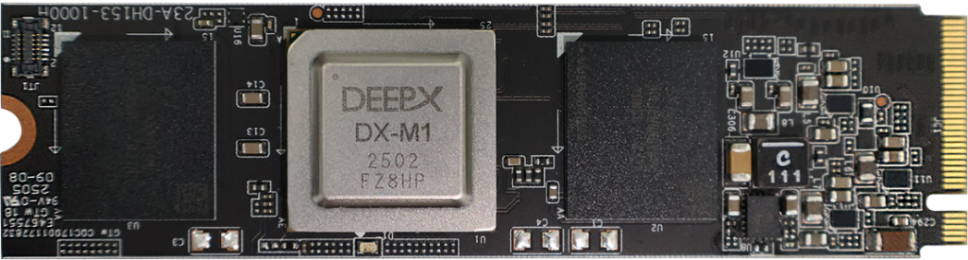
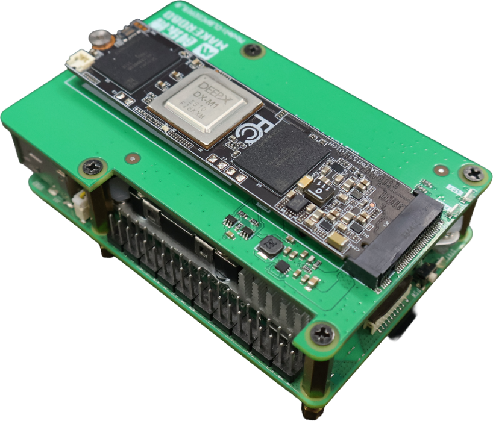
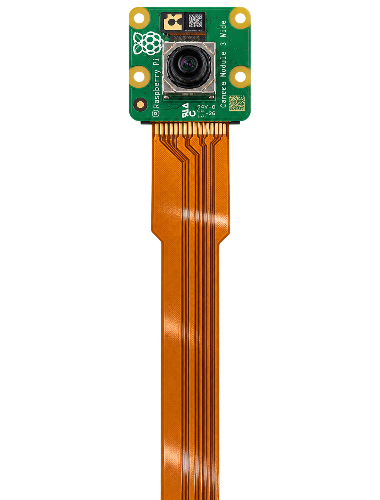
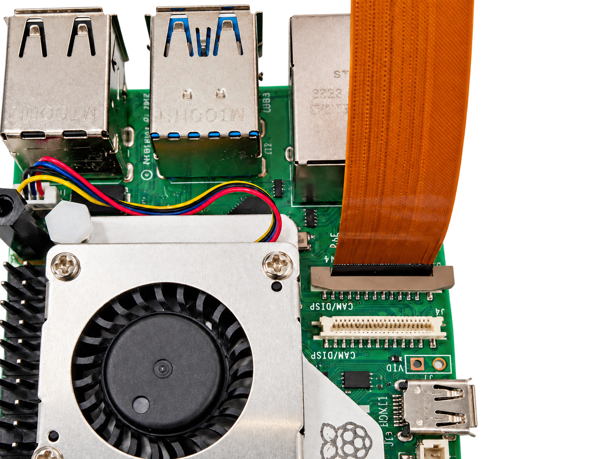

This chapter provides a technical overview of the **DEEPX DX-M1** accelerator and its integration environment.

## Hardware Architecture: DX-M1 M.2 

The system utilizes a high-performance heterogeneous architecture specifically engineered to support demanding edge AI workloads.

### DX-M1 M.2 on Raspberry Pi 5

The DEEPX DX-M1 is a high-efficiency AI inference accelerator designed for seamless integration into edge computing environments through its optimized internal architecture. The table below shows how the DX-M1 M.2 module operates when it is connected to a Raspberry Pi 5.  

  
  
Figure. DX-M1 M.2 Architecture

Table. DX-M1 M.2 on Raspberry Pi 5  

| Features | Details |
|---|---|
| AI Performance | 25 TOPS (INT8) |
| PCIe Link | **x1** (single lane) through the Raspberry Pi 5 external PCIe connector Gen2 (5 GT/s) by default, Gen3 (8 GT/s) optional (see [Getting Started](03_Getting_Started.md) > **PCIe Configuration**) The module supports x1/x2/x4 widths and Gen 1/2/3, so it operates normally on a single lane. |
| NPU Memory | 4GB LPDDR5 (5600 MT/s), on the module |
| Power Consumption | 1W (min) ~ 5W (max), supplied by the Raspberry Pi 5 through the M.2 HAT |
| Form Factor | M.2 2280 (M Key), 22 x 80 mm — requires a 2280-compatible M.2 HAT |
| OS | Raspberry Pi OS (64-bit), Debian 13 "trixie" (`arm64`) |
| AI Models | Runs pre-compiled `.dxnn` models. To use your own model (Ultralytics, PyTorch, TensorFlow, ONNX, Keras), compile it to `.dxnn` with DX-COM on an x86-64 Linux host, then copy it to the Raspberry Pi 5. Model compilation is not supported on the Raspberry Pi 5. |

The values above are for the DX-M1 M.2 module. The **DX-M1M M.2 module** is M.2 2242 (M+B Key), 22 x 42 x 4.9 mm, with integrated 2GB LPDDR4x memory. For all hardware options, including the Sixfab AI HAT+, see [Before You Start](00_Before_You_Start.md) > **Choose Your Hardware**.  

---

## Hardware Installation and I/O Setup

This section outlines the physical integration of the DEEPX DX-M1 accelerator. Prepare the parts listed in [Before You Start](00_Before_You_Start.md) > **Required Parts**, then follow these steps to ensure the host system and hardware components are properly configured for a stable edge AI environment.

### Step-by-Step Connection Guide

**Step 1. Raspberry Pi 5 Initial Setup**  

Complete the basic OS and power configuration by referring to the official documentation:  

- [Getting started with your Raspberry Pi](https://www.raspberrypi.com/documentation/computers/getting-started.html)  

**Step 2. Connecting the DX-M1 M.2 Module**  

Once the host is prepared, power off the Raspberry Pi 5 and disconnect the power supply. Then install the **DX-M1 M.2 NPU module** on a 2280-compatible PCIe M.2 HAT as shown below.  
 

  
  
Figure. DEEPX DX-M1 AI Accelerator for Raspberry Pi 5

> [!NOTE]
> If you use the **Sixfab AI HAT+**, refer to the [Sixfab AI HAT+ Quickstart](https://docs.sixfab.com/docs/ai-hat-plus-raspberry-pi-5-quickstart) for assembling the board. Then install the SDK by following [Getting Started](03_Getting_Started.md).

**Step 3. Connecting the Raspberry Pi Camera Module 3**  

To run the camera input demos, connect the **Raspberry Pi Camera Module 3** to the CAM/DISP 0 or CAM/DISP 1 connector on the Raspberry Pi 5.  

  
  
Figure. Raspberry Pi Camera Module 3

- Power off the Raspberry Pi 5 and disconnect the power supply.  
- Gently lift the latch of the CAM/DISP 0 or CAM/DISP 1 connector.  
- Insert the camera cable fully and straight into the connector.  
- Press the latch down to secure the cable, as shown below.  

  
  
Figure. Camera Cable Connected to the Raspberry Pi 5 Camera Connector

> [!NOTE]
> The Raspberry Pi 5 uses mini 22-pin camera connectors, while the cable included with the Camera Module 3 is a standard 15-pin cable. A **Standard-to-Mini camera cable is required** to connect the camera to the Raspberry Pi 5.

---
