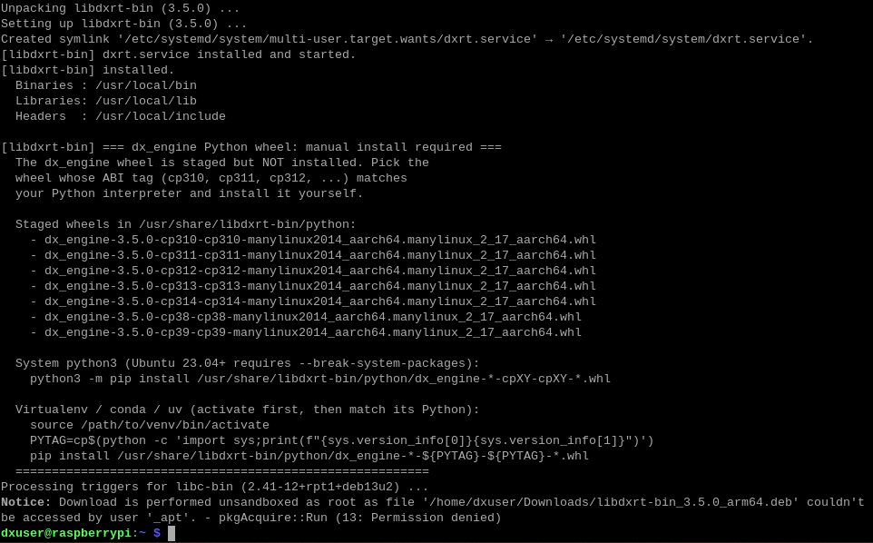
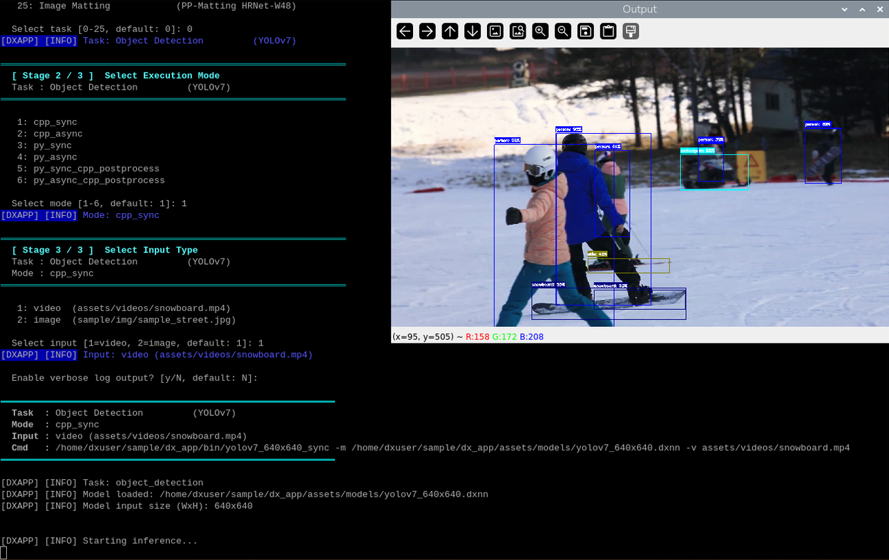
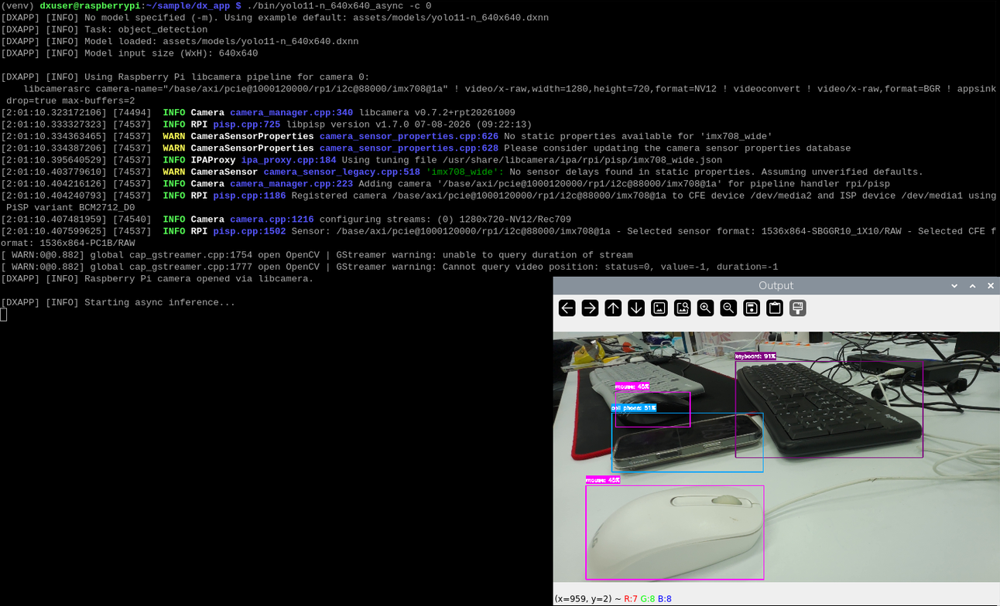
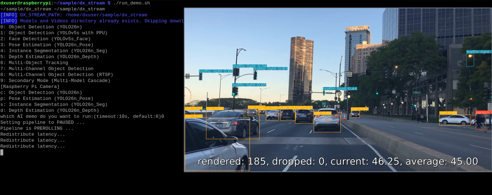
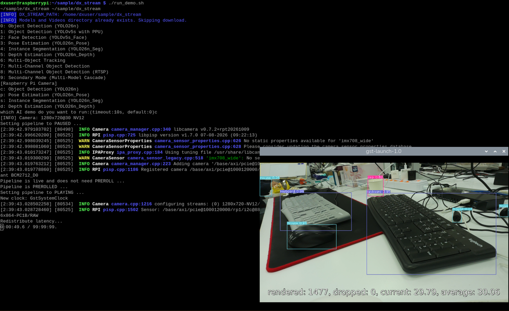
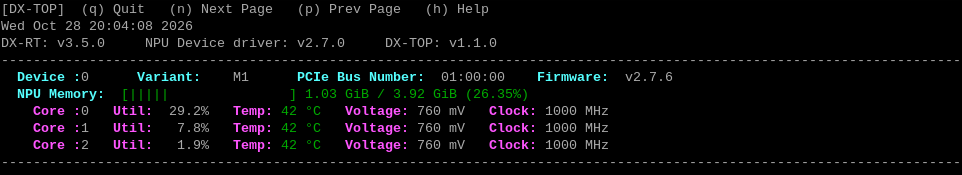

This chapter provides a concise guide to configuring the **DEEPX DX-M1** development environment. It covers the essential steps from verifying system requirements to executing your first AI inference benchmarks.  

> [!NOTE]
> **SDK versions used in this chapter:** DX-All-Suite v2.5.0 — DX-RT 3.5.0 · NPU Driver 2.7.0 · DX-FW 2.7.6 · DX-APP 3.3.0 · DX-Stream 3.2.0
>
> Mixing versions from different DX-All-Suite releases is not supported. See the [DX-All-Suite release notes](https://github.com/DEEPX-AI/dx-all-suite/blob/main/RELEASE_NOTES.md) for the full combination.

## System Prerequisites

Before proceeding with the driver installation, ensure the host system is properly configured by following these environment preparation steps.  

### Hardware Checklist

Make sure the parts listed in [Before You Start](00_Before_You_Start.md) > **Checklist** are ready and the hardware is assembled as described in [System Overview](02_System_Overview.md) > **Step-by-Step Connection Guide**.  

### Environment Preparation

**Step 1. Install Raspberry Pi OS (64-bit)**  

- Download and install **Raspberry Pi OS (64-bit)** using the **Raspberry Pi Imager**. The current release is based on Debian 13 "trixie".  
- The DEEPX runtime package is built for `arm64`. A 32-bit OS is not supported.  
- Link: [https://www.raspberrypi.com/software/](https://www.raspberrypi.com/software/)  

After the first boot, confirm that the OS is 64-bit. The output must be `arm64`.

```bash
dpkg --print-architecture
```

**Step 2. Connect to the Internet**  

- Verify that the Raspberry Pi has an active **Internet connection**.  
- A stable connection is required to access external repositories and download necessary dependencies during the setup process.  

**Step 3. Connect and Verify the Camera**  

- Connect the **Raspberry Pi Camera Module 3** as described in [System Overview](02_System_Overview.md) > **Step 3. Connecting the Raspberry Pi Camera Module 3**.  
- Run the following command to verify that the camera is recognized.  

```bash
rpicam-hello --list-cameras
```

If the camera is recognized correctly, an `imx708` sensor is listed in the output (for example, `imx708` or `imx708_wide`, depending on the camera variant).  

---

## PCIe Configuration

The DX-M1 is connected through the Raspberry Pi 5 external PCIe connector, which provides a single PCIe lane (x1). Configure PCIe **before** installing the driver so that the module is detected when the driver loads.  

**Step 1. Open the configuration file**  

```bash
sudo nano /boot/firmware/config.txt
```

> [!NOTE]
> In older versions of the OS, the path may be `/boot/config.txt`.

**Step 2. Add the PCIe parameters**  

Add the following lines at the end of the file, under the `[all]` section.

```text
# Enable the PCIe external connector (M.2 HAT)
dtparam=pciex1

# Use PCIe Gen3 speed (optional, see the caution below)
dtparam=pciex1_gen=3
```

- `dtparam=pciex1` enables the external PCIe connector. HATs that follow the HAT+ specification enable it automatically, but adding the line is harmless.  
- `dtparam=pciex1_gen=3` raises the link from the default Gen2 (5 GT/s) to Gen3 (8 GT/s). This increases the host-to-NPU transfer bandwidth, which improves end-to-end throughput. It does not change the NPU's own compute performance.  

> [!CAUTION]
> The Raspberry Pi 5 is **not certified** for PCIe Gen3 speeds, and Gen3 connections may be unstable. If you see boot failures, PCIe errors in `dmesg`, or the module is not detected, remove the `dtparam=pciex1_gen=3` line to return to the default Gen2 speed.

**Step 3. Save and Exit**  

Press **Ctrl + O**, then **Enter** to save the changes, and press **Ctrl + X** to exit the editor.  

**Step 4. Reboot the system**  

```bash
sudo reboot
```

**Step 5. Verify that the module is detected**  

After rebooting, confirm that the DX-M1 appears on the PCIe bus and check the negotiated link speed.

```bash
lspci -d 1ff4:
sudo lspci -vv -d 1ff4: | grep -i "LnkSta:"
```

`1ff4` is the PCI vendor ID of DEEPX. The `-d 1ff4:` option limits the output to the DEEPX NPU, so other PCIe devices on the Raspberry Pi 5 are not shown.  

- The DX-M1 should be listed in the `lspci -d 1ff4:` output. If nothing is listed, see [Appendix. Troubleshooting](04_Appendix.md) > **Q2. DX-M1 Module Is Not Detected** before installing the driver.  
- If `LnkSta` shows **Speed 8GT/s**, the link is operating at **PCIe Gen3**.  
- If `LnkSta` shows **Speed 5GT/s**, the link is operating at **PCIe Gen2**.  
- `LnkSta` shows **Width x1** on the Raspberry Pi 5. This is expected.  

---

## Software Setup and Demo Execution

This section provides a brief guide to installing the necessary drivers and executing AI inference benchmarks using the **DEEPX DX-M1** accelerator.  

### Install DEEPX DX-M1 Driver and Runtime

Follow these steps to download and install the **DEEPX Runtime (DX-RT)** library, known as `libdxrt`, along with the necessary driver modules.  

> [!NOTE]
> Install the driver and runtime with the steps below for every hardware option, including the **Sixfab AI HAT+**. The packages are pinned to DX-All-Suite v2.5.0, which the sample applications in this guide require. If the SDK was already installed with another package, check with `dxcli -s` that the DX-RT and driver versions match the versions listed at the top of this chapter.

**Step 1. Download the Debian Packages**  

Execute the following commands to download the Debian packages to the `~/Downloads` folder.  

```bash
wget -P ~/Downloads https://github.com/DEEPX-AI/dx_rt_npu_linux_driver/raw/refs/tags/v2.7.0/release/2.7.0/dxrt-driver-dkms_2.7.0-2_all.deb
wget -P ~/Downloads https://github.com/DEEPX-AI/dx_rt/raw/refs/tags/v3.5.0/release/3.5.0/libdxrt-bin_3.5.0_arm64.deb
```

**Step 2. Installation of DXRT and Driver**  

Install the NPU driver first, then the DEEPX Runtime (DX-RT) library.  

```bash
sudo apt install -y ~/Downloads/dxrt-driver-dkms_2.7.0-2_all.deb
sudo apt install -y ~/Downloads/libdxrt-bin_3.5.0_arm64.deb
```

<div align="left" markdown="1">
  
  <p markdown="1">Figure. DEEPX Runtime Library (`libdxrt`) Installation Progress</p>
</div>

> [!NOTE]
> The driver is built by DKMS for the running kernel. After a kernel update (for example, by `sudo apt full-upgrade`), reboot and confirm that the module was rebuilt with `dkms status`. See [Appendix. Troubleshooting](04_Appendix.md) > **Q3. Driver Is Not Loaded After a Kernel Update**.

**Step 3. Hardware Status Verification**  

Confirm that the DEEPX DX-M1 module is correctly interfaced and recognized by the system.  

```bash
dxcli -s
```

If the module is recognized, the device status is printed as shown below.

```text
DXRT v3.5.0 (build: 5.502926e)
=======================================================
 * Device 0: M1, Accelerator type
---------------------   Version   ---------------------
 * RT Driver version   : v2.7.0
 * PCIe Driver version : v2.7.0
-------------------------------------------------------
 * FW version          : v2.7.6 (build: 5.974f823)
--------------------- Device Info ---------------------
 * Memory : LPDDR5 5600 Mbps, 3.92GiB
 * Board  : M.2, Rev 1.0
 * Chip Offset : 0
 * PCIe   : Gen3 X1 [01:00:00]

NPU 0: voltage 750 mV, clock 1000 MHz, temperature 36'C
NPU 1: voltage 750 mV, clock 1000 MHz, temperature 35'C
NPU 2: voltage 750 mV, clock 1000 MHz, temperature 35'C
=======================================================
```

- `Device 0` is listed: the module is recognized.  
- `RT Driver version` and `PCIe Driver version` show the installed NPU driver.  
- `FW version` shows the current firmware. Check it in the next section, **Firmware Check and Update**.  
- `PCIe` shows the link speed and width. `Gen3 X1` is expected when PCIe Gen3 is enabled, and `Gen2 X1` otherwise.  

### Firmware Check and Update  

The device firmware **must** meet the minimum version required by the installed DX-RT library. Update the firmware only when the current version is lower than the minimum.  

**Step 1. Check the minimum and current versions**  

Print the minimum driver and firmware versions required by the installed DX-RT.

```bash
dxcli -v
```

Then check the current firmware version in the `FW version` line of the device status.

```bash
dxcli -s
```

- If the `FW version` is equal to or higher than the minimum firmware version, no update is needed. Continue with **Execution of Sample Applications**.  
- If the `FW version` is lower than the minimum, or a `[dxrt-exception] Invalid operation` error occurs during model execution, update the firmware as described below.  

**Step 2. Download the firmware**  

Download the firmware bundled with DX-All-Suite v2.5.0 (DX-FW 2.7.6) for your module from the official DEEPX firmware repository.  

For the **DX-M1** M.2 module:

```bash
wget -P ~/Downloads https://github.com/DEEPX-AI/dx_fw/raw/refs/tags/v2.7.6/m1/2.7.6/mdot2/fw.bin
```

For the **DX-M1M** M.2 module:

```bash
wget -P ~/Downloads https://github.com/DEEPX-AI/dx_fw/raw/refs/tags/v2.7.6/m1m/2.7.6/mdot2/fw.bin
```

- For the **Sixfab AI HAT+**, follow the firmware instructions in the [Sixfab AI HAT+ documentation](https://docs.sixfab.com/docs/ai-hat-plus-raspberry-pi-5-quickstart).  
- Repository and release notes: [https://github.com/DEEPX-AI/dx_fw](https://github.com/DEEPX-AI/dx_fw)

**Step 3. Update the firmware**  

First, check the version of the downloaded firmware file.

```bash
dxcli -g ~/Downloads/fw.bin
```

Then stop the runtime service, update the firmware, and restart the service.

```bash
sudo systemctl stop dxrt.service
dxcli -u ~/Downloads/fw.bin
sudo systemctl start dxrt.service
```

Finally, confirm that the `FW version` in the device status now meets the minimum.

```bash
dxcli -s
```

> [!CAUTION]
> **Do not power off** the device during the update to prevent permanent hardware damage.
 
### Execution of Sample Applications

The sample applications are cloned at the release tag that matches DX-All-Suite v2.5.0. Do not clone the default branch, because it may contain a newer version that requires a different runtime.  

> [!NOTE]
> The demos display their results in a window. Run them in a terminal on the Raspberry Pi desktop. When working remotely, connect to the desktop with VNC (or Raspberry Pi Connect) instead of a plain SSH session, which has no display.

**A. AI Inference Demo (`dx_app`)**  

The `dx_app` demonstrates real-time AI inference capabilities. On first run, `run_demo.sh` automatically downloads the sample videos and the pre-compiled models used by the selected demo.  

```bash
mkdir -p ~/sample
cd ~/sample
git clone --branch v3.3.0 https://github.com/DEEPX-AI/dx_app.git
cd ~/sample/dx_app
./install.sh --all --venv_path ./venv
source ./venv/bin/activate
./run_demo.sh
```

<div align="left" markdown="1">
  
  <p>Figure. `dx_app` Video Demo: Demo Menu Selection (terminal) and Real-time Object Detection Result (result window)</p>
</div>

> [!NOTE]
> `./install.sh --all` installs build dependencies, including OpenCV, from system packages. This step may take several minutes. To run the demo again later, run `source ./venv/bin/activate` and `./run_demo.sh` from `~/sample/dx_app`.

> [!NOTE]
> The default execution mode (`cpp_sync`) runs without additional packages. To use the Python execution modes (`py_sync`, `py_async`, `py_sync_cpp_postprocess`, `py_async_cpp_postprocess`), install the `dx_engine` Python package in the activated virtual environment. The wheel that matches your Python version is selected automatically.
>
> ```bash
> pip install dx_engine --find-links /usr/share/libdxrt-bin/python
> ```

**Camera Input Demo (`dx_app`)**  

The `run_demo.sh` script supports video and image inputs only. To run real-time inference on a camera input, execute an example directly with the `-c <camera index>` option.  

```bash
cd ~/sample/dx_app
source ./venv/bin/activate
./bin/yolo11-n_640x640_async -c 0
```

The example automatically detects the connected camera, either a USB webcam or the Raspberry Pi camera, and runs with it. For the Raspberry Pi camera, use the camera index shown by `rpicam-hello --list-cameras` (for example, `0`).  

<div align="left" markdown="1">
  
  <p>Figure. `dx_app` Camera Input Demo: Camera Inference Command (terminal) and Real-time Object Detection Result (result window)</p>
</div>

> [!NOTE]
> If a USB webcam and the Raspberry Pi camera are connected at the same time, `-c 0` opens the USB webcam. To use the Raspberry Pi camera, disconnect the USB webcam.

**B. GStreamer Plugin Demo (`dx_stream`)**  

The `dx_stream` sample is optimized for high-performance video streaming pipelines utilizing the GStreamer framework. On first run, `run_demo.sh` automatically downloads the sample models and videos.  

```bash
cd ~/sample
git clone --branch v3.2.0 https://github.com/DEEPX-AI/dx_stream.git
cd ~/sample/dx_stream
./install.sh
./build.sh
source ~/.bashrc
./run_demo.sh
```

> [!NOTE]
> `./build.sh` adds the environment variables for the `dx_stream` GStreamer plugin to `~/.bashrc`. They do not apply to the terminal that is already open, so run `source ~/.bashrc` (or open a new terminal) before the first `./run_demo.sh`. Otherwise, `run_demo.sh` stops with `dxstream plugin still not found`. Refer to [Appendix. Troubleshooting](04_Appendix.md) > **Q7. dx_stream Plugin Is Not Found**.

<div align="left" markdown="1">
  
  <p>Figure. `dx_stream` GStreamer Pipeline: Demo Menu Selection (terminal) and Multi-Object Detection Result (result window)</p>
</div>

**Camera Input Demo (`dx_stream`)**  

When the Raspberry Pi Camera Module 3 is connected, `run_demo.sh` lists additional **[Raspberry Pi Camera]** demos. Enter one of the following keys at the demo menu to run inference on the camera input.  

- `c`: Object Detection (YOLO26n)  
- `p`: Pose Estimation (YOLO26n_Pose)  
- `s`: Instance Segmentation (YOLO26n_Seg)  
- `d`: Depth Estimation (YOLO26n_Depth)  

```bash
cd ~/sample/dx_stream
./run_demo.sh
```

<div align="left" markdown="1">
  
  <p>Figure. `dx_stream` Camera Input Demo: Demo Menu Selection (terminal) and Real-time Object Detection Result (result window)</p>
</div>

> [!NOTE]
> The demo menu waits for 10 seconds. If no selection is made within this time, demo 0 runs by default.

### System Monitoring

**NPU Utilization (`dxtop`)**  

The `dxtop` utility provides a real-time CLI (Command Line Interface) to monitor NPU utilization, temperature, and operational status.  

```bash
dxtop
```

<div align="left" markdown="1">
  
  <p>Figure. Real-time NPU Resource Monitoring via `dxtop`</p>
</div>

---
